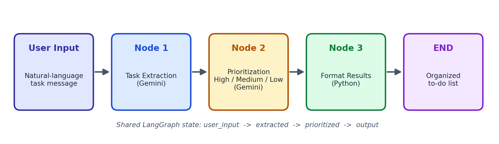

# SmartTask AI

Turn a messy, informal message like

> "I need to finish my assignment tomorrow, buy groceries today, and prepare for my meeting next week."

into an organized, prioritized to-do list. **Gemini** does the language understanding, **LangGraph** manages the workflow, **FastAPI** serves the API and a simple web UI.

## Workflow

```
User input -> Node 1: Task extraction (Gemini)
           -> Node 2: Task prioritization High/Medium/Low (Gemini)
           -> Node 3: Format results (Python)
           -> END: organized to-do list
```



## Project structure

```
smarttask-ai/
├── backend/
│   ├── app/
│   │   ├── graph.py      # LangGraph workflow (3 nodes)
│   │   ├── schemas.py    # Pydantic models
│   │   └── main.py       # FastAPI app (API + serves frontend)
│   ├── requirements.txt
│   └── .env.example
├── frontend/
│   └── index.html        # Web UI (HTML/CSS/JS)
├── docs/                 # workflow diagram, report, presentation
└── README.md
```

## Setup

### 1. Get a free Gemini API key
1. Open https://aistudio.google.com/app/apikey
2. Sign in with your Google account and click **Create API key**
3. Copy the key

### 2. Install and configure
```bash
cd smarttask-ai/backend
python -m venv venv
venv\Scripts\activate          # Windows   (Mac/Linux: source venv/bin/activate)
pip install -r requirements.txt
copy .env.example .env         # Mac/Linux: cp .env.example .env
```
Open `.env` and paste your key after `GOOGLE_API_KEY=`.

### 3. Run
```bash
uvicorn app.main:app --reload
```
Open http://127.0.0.1:8000 in your browser. API docs: http://127.0.0.1:8000/docs

## API

`POST /api/organize`

Request:
```json
{ "message": "Finish assignment tomorrow, buy groceries today, prepare meeting next week" }
```
Response:
```json
{
  "tasks": [
    { "title": "Buy groceries", "deadline": "today", "priority": "High", "reason": "Due today." }
  ],
  "formatted": "YOUR ORGANIZED TO-DO LIST ..."
}
```

## Notes
- Model name is configurable with `GEMINI_MODEL` in `.env` (default `gemini-3.6-flash`). If Google retires a model name, set a current one from https://ai.google.dev/gemini-api/docs/models.
- Never commit your real `.env` file (it is in `.gitignore`).
